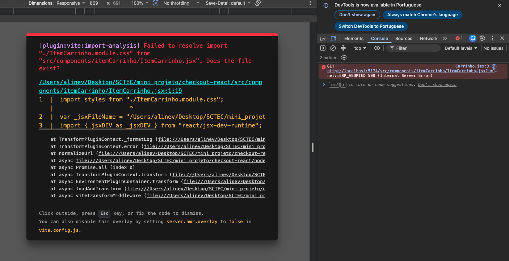

# Closet Express 

SPA de checkout simulado para uma loja de roupas virtual, construída em React como projeto avaliativo do módulo de Front-End React (SENAI/SCTEC).

## Sobre o projeto

Uma loja virtual precisa de uma interface para finalizar compras, com navegação fluida entre telas, validação de formulário e uma simulação de pagamento — sem back-end real. O usuário confere os produtos do carrinho, informa dados fictícios de cartão, e recebe o resultado da compra (aprovada ou reprovada) de forma instantânea, sem recarregar a página.

O projeto foi desenvolvido individualmente, praticando os principais conceitos do módulo: componentes funcionais, props, listas, hooks (`useState`, custom hooks), formulários com validação, rotas dinâmicas e simulação assíncrona.

##  Tecnologias utilizadas

- **React** + **Vite** — SPA, sem back-end
- **React Router** — rotas e navegação entre telas, incluindo rota dinâmica (`/resultado/:status`)
- **React Hook Form** + **Zod** — gerenciamento e validação do formulário de pagamento
- **CSS Modules** — estilização isolada por componente, sem bibliotecas externas
- **Google Fonts** — Inter (texto), Playfair Display (títulos) e Cormorant Garamond (logotipo da loja)
- **Git/GitHub** — controle de versão com fluxo de branches (`main` → `develop` → `feature/*`)

##  Funcionalidades

- Carrinho fixo com 3 produtos, subtotal por item e total geral, formatados em reais
- Navegação entre carrinho → pagamento → resultado, com o valor total passado entre as telas via `state` do React Router
- Formulário de pagamento com validação de titular, número do cartão (16 dígitos, desconsiderando espaços/hífens), validade (MM/AA) e CVV
- Regra de simulação: cartões com todos os dígitos iguais são identificados como tentativa de fraude
- Processamento assíncrono simulado (~3s), com botão desabilitado durante a espera, via custom hook `usePagamento`
- **Rota dinâmica** (`/resultado/:status`) para as telas de sucesso e falha — diferencial do desafio, usando `useParams`
- Componentização com `ItemCarrinho`, `CampoFormulario`, `Header` e `Footer`, todos reutilizáveis via props ou usados em conjunto com as rotas
- Identidade visual de loja: cabeçalho com o nome "Closet Express", paleta em tons de preto, branco e marrom, e rodapé fixo em todas as páginas
- Layout responsivo (mobile-first) e acessível — validado com Lighthouse: **100/100 em Acessibilidade**, **100/100 em Boas Práticas**

## Estrutura de pastas

```
checkout-react/
- src/
  - pages/
    - carrinho/ (Carrinho.jsx + Carrinho.module.css)
    - pagamento/ (Pagamento.jsx + Pagamento.module.css)
    - resultado/ (Resultado.jsx + Resultado.module.css, rota dinâmica)
  - components/
    - itemCarrinho/ (ItemCarrinho.jsx + .module.css)
    - campoFormulario/ (CampoFormulario.jsx + .module.css)
    - header/ (Header.jsx + .module.css, nome da loja)
    - footer/ (Footer.jsx + .module.css)
  - hooks/
    - usePagamento.js (custom hook do processamento assíncrono)
  - utils/
    - pagamentoSchema.js (schema de validação com Zod)
    - verificarGolpe.js (regra de detecção de cartão suspeito)
  - data/
    - produtos.js (array fixo de produtos)
  - App.jsx (configuração das rotas)
  - main.jsx (ponto de entrada, com BrowserRouter)
```

##  Como executar

```bash
git clone <https://github.com/aline-volpatto/checkout-react>
cd checkout-react
npm install
npm run dev
```

Acesse `http://localhost:5173` no navegador.

##  Como testar o fluxo

1. Na tela inicial (carrinho), clique em **Finalizar Compra**
2. Preencha o formulário com dados fictícios:
   - **Cartão normal** (ex: `1234 5678 9012 3456`) → compra aprovada
   - **Cartão com todos os dígitos iguais** (ex: `1111 1111 1111 1111`) → tentativa de golpe

##  Uso do debugger

Durante a criação da pasta itemCarrinho e demais arquivos contidos nesta pasta, me deparei com um erro persistente: Failed to resolve import "./ItemCarrinho.module.css". Does the file exist?, mesmo com o arquivo existindo exatamente no caminho indicado.

Usei o Console do DevTools do navegador para capturar a mensagem de erro completa (imagem abaixo) e, a partir dela, investiguei metodicamente as possíveis causas, seguido por auxílio de IA: reiniciei o servidor Vite e limpei o cache (node_modules/.vite), verifiquei duplicidade de processos rodando em terminais diferentes, e confirmei via terminal (ls -la, cat) que o arquivo existia com o nome e conteúdo esperados. Como nenhuma dessas hipóteses explicava o erro, fui para o console novamente, onde suspeitei que eu pudesse ter digitado algo erroneamente. Quando cliquei em cima do nome para renomear, percebi um leve desalinhamento em relação à linha superior, ou seja, havia digitado um espaço antes do nome do arquivo. Apaguei a linha, digitei ela novamente e o erro desapareceu, confirmando a suspeita.



##  Organização do trabalho (Kanban)

Board do Trello com todos os cards: [Kanban - Checkout Express](https://trello.com/b/c1jmAJkY/checkout-express)

##  Vídeo de apresentação

[_LINK DO VIDEO_](https://drive.google.com/file/d/1Xaqc8xfJRLlhQO__yH0jlikD2VqfF9bt/view?usp=sharing)

##  Melhorias futuras

- Persistir o carrinho em `localStorage` para simular continuidade entre sessões
- Adicionar validação de bandeira do cartão (Visa, Mastercard etc.) via prefixo numérico
- Testes automatizados (unitários para `verificarGolpe` e `pagamentoSchema`)
- Dark mode, usando as CSS Custom Properties já estruturadas no `index.css`


##  Autora

Aline Volpatto
[GitHub](https://github.com/aline-volpatto) · [LinkedIn](https://linkedin.com/in/aline-volpatto-95b991294)